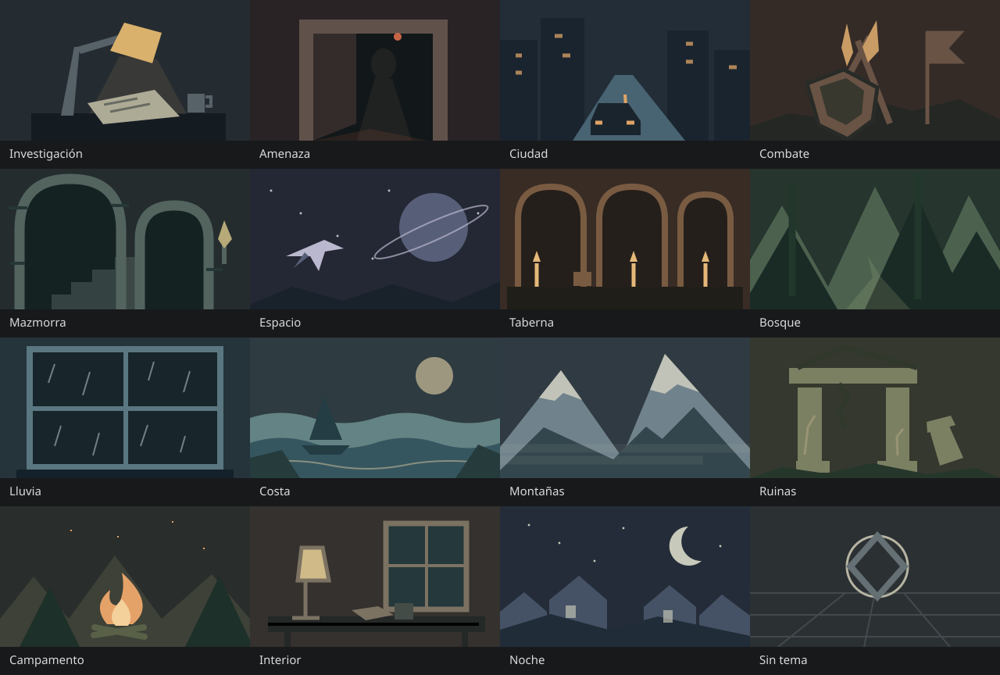

# Ilustraciones de escenas

Las ilustraciones permiten reconocer escenas por su silueta y paleta, junto al nombre. Son SVG originales incluidos con la aplicación, sin descargas de imágenes externas, animaciones ni fuentes adicionales.

## Repertorio

Investigación, amenaza, ciudad, combate, mazmorra, espacio, taberna, bosque, lluvia, costa, montañas, ruinas, campamento, interior, noche y una ilustración neutra «Sin tema».

Cada escena de ejemplo tiene una imagen asignada. Todas las imágenes también están disponibles para las escenas del usuario.

## Uso

- **Guardar escena** incluye un selector de ilustración con previsualizaciones y nombres.
- En **Mis escenas**, la acción **Cambiar ilustración** permite editar la imagen de una escena existente sin sustituir pistas ni volúmenes ni iniciar la reproducción.
- La ilustración se guarda como identificador en `Scene.art` y se conserva al exportar/importar JSON.
- Las escenas antiguas sin `art` usan «Sin tema». Un identificador futuro desconocido también muestra esa imagen, conservando el valor importado hasta que se edite explícitamente.
- No se admiten URLs arbitrarias ni subida de imágenes en esta versión.

## Diseño y accesibilidad

En escritorio, una miniatura acompaña al nombre y descripción del preset. En móvil, las tarjetas se recorren horizontalmente para mantener la biblioteca y el transporte accesibles. Las escenas guardadas muestran una miniatura en su fila.

El selector usa radios nativos con etiquetas, foco y estado seleccionado visibles. Las imágenes son decorativas para lectores de pantalla porque cada control tiene un nombre textual. Los SVG no contienen recursos externos ni identificadores que entren en conflicto al repetirse.

## Datos y licencia

Se mantiene `schemaVersion: 1`: `art` ya era un campo opcional. Sus valores deben ser cadenas; las escenas anteriores no necesitan una migración ni una sobrescritura de almacenamiento. Los identificadores estables y las etiquetas se definen en `src/sceneArt.ts` y los dibujos en `src/components/SceneIllustration.tsx`.

Las ilustraciones originales están cubiertas por la licencia restrictiva del proyecto. No se modifican las licencias de audio ni de dependencias.
